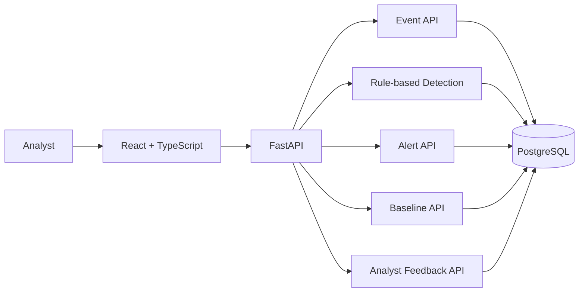
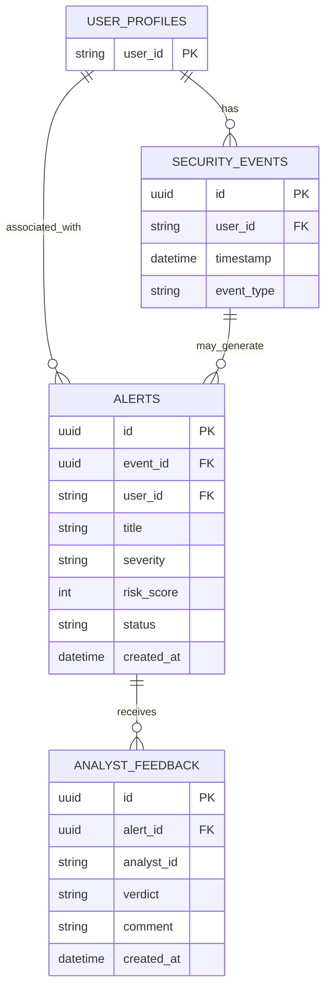

# UEBA Platform

A User and Entity Behavior Analytics (UEBA) platform for security operations teams. It ingests security events, applies explainable rule-based anomaly detection, creates alerts, and records analyst feedback.

> **Status:** The application works locally. ML development is intentionally paused. Authentication, authorization, and production hardening remain future work.

## 1. Features

- Ingest and browse security events.
- Build and retrieve user behavioral baselines.
- Analyze events using the current rule-based detector.
- Create, filter, inspect, and update security alerts.
- Submit analyst verdicts and comments.
- View operational data through a React dashboard.

## 2. Tech Stack

- **Frontend:** React, TypeScript, Vite
- **Backend:** Python, FastAPI, Uvicorn
- **Validation/configuration:** Pydantic, pydantic-settings
- **Database/ORM:** PostgreSQL, SQLAlchemy
- **Local services:** Docker Compose
- **Tests:** pytest

## 3. Architecture



## 4. ER Diagram



The diagram summarizes the intended entity relationships. Confirm field names and foreign-key constraints against the current SQLAlchemy models before using it as a database migration specification.

## 5. Project Structure

```text
ueba-platform/
├── backend/
│   ├── app/
│   │   ├── api/routes/       # API endpoints
│   │   ├── models/           # SQLAlchemy models
│   │   ├── schemas/          # Pydantic schemas
│   │   ├── services/         # Baseline and detection logic
│   │   ├── config.py
│   │   ├── database.py
│   │   └── main.py
│   └── tests/
├── frontend/
│   └── src/                  # React UI and API client
├── docker-compose.yml
└── README.md
```

ML-related files remain in the repository but are not part of the active workflow.

## 6. Requirements

- Python 3.12
- Node.js and npm
- Docker with Docker Compose
- Git

## 7. Configuration

Create a local `.env` file using the environment variable names expected by `backend/app/config.py` and `docker-compose.yml`. Never commit `.env`, passwords, API keys, or other secrets.

The current local setup uses PostgreSQL host port **5433** and backend port **8001**.

Example database URL format (use your own local credentials):

```text
postgresql+psycopg://<username>:<password>@127.0.0.1:5433/<database>
```

## 8. Run Locally

### Start the database

```bash
cd "$HOME/Projects/ueba-platform"
docker compose up -d
docker compose ps
```

### Start the backend

```bash
cd "$HOME/Projects/ueba-platform/backend"
source ../.venv312/bin/activate
uvicorn app.main:app --reload --host 127.0.0.1 --port 8001
```

API documentation: http://127.0.0.1:8001/docs

### Start the frontend

In a separate terminal:

```bash
cd "$HOME/Projects/ueba-platform/frontend"
npm install
npm run dev
```

Open the URL printed by Vite, usually http://localhost:5173.

### Build the frontend

```bash
cd "$HOME/Projects/ueba-platform/frontend"
npm run build
```

## 9. API Endpoints

Check `/docs` for exact request schemas and query parameters.

| Method | Endpoint | Purpose |
|---|---|---|
| `GET` | `/health` | API health |
| `GET` | `/health/db` | Database health |
| `POST` | `/events` | Ingest an event |
| `GET` | `/events` | List events |
| `POST` | `/baselines/{user_id}/rebuild` | Rebuild a user baseline |
| `GET` | `/baselines/{user_id}` | Retrieve a user baseline |
| `POST` | `/anomalies/analyze/{event_id}` | Analyze a stored event |
| `GET` | `/alerts` | List alerts |
| `GET` | `/alerts/{alert_id}` | Retrieve an alert |
| `PATCH` | `/alerts/{alert_id}/status` | Update alert status |
| `POST` | `/alerts/{alert_id}/feedback` | Submit analyst feedback |
| `GET` | `/alerts/{alert_id}/feedback` | List analyst feedback |

Alert statuses: `open`, `investigating`, `resolved`, `dismissed`.

Feedback verdicts: `true_positive`, `false_positive`, `benign`, `inconclusive`.

## 10. Tests

Run backend tests:

```bash
cd "$HOME/Projects/ueba-platform/backend"
source ../.venv312/bin/activate
PYTHONPATH=. python -m pytest -q
```

Run frontend checks:

```bash
cd "$HOME/Projects/ueba-platform/frontend"
npm run build
npm run lint
```

## 11. Security Notes

This is a development/MVP project, not yet production-hardened. Before deployment:

- Add authentication and server-side authorization.
- Derive analyst identity from authenticated credentials, not a client-supplied ID.
- Restrict CORS to trusted origins.
- Keep secrets out of Git and use least-privilege database credentials.
- Add audit logging, rate limiting, backups, and security tests.
- Use TLS and restrict database network access.

Use synthetic events during development and do not publish confidential security telemetry.

## 12. Roadmap

- [ ] Authentication and authorization
- [ ] Complete API and end-to-end test coverage
- [ ] Production deployment configuration and monitoring
- [ ] Review baseline data windows and event deduplication
- [ ] Resume ML training and integration when explicitly planned

## License

No license has been added yet. Add a `LICENSE` file before distributing the project as open source.
