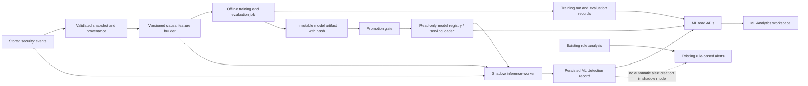

# ML Analytics Architecture

## Purpose and non-goals

This document proposes a future architecture for operational ML Analytics in the existing UEBA platform. It does not select an ML algorithm, authorize training/deployment, or describe current operational model data. The current state is documented in [`ML_CURRENT_STATE.md`](ML_CURRENT_STATE.md).

The design keeps ML detection separate from the active rule-based detector until a candidate has passed data-quality, validation, security, and analyst-review gates. It must not present synthetic reports as live model results.

**Current update:** a clearly labeled ML Analytics page is backed by `GET /ml-analytics/demo`. It recomputes only the bundled synthetic demonstration and held-out evaluation in memory. It is not an event inference/status API and has no database or alert side effects. The operational architecture below remains a future design for any approved live/shadow integration.

## Architectural principles

1. **Keep evidence provenance.** Every displayed model, metric, and detection must be returned by a backend record tied to a model version, evaluation run, data window, and feature schema.
2. **Separate score meanings.** An ML anomaly score/decision function, a binary model output, and the existing 0–100 rule-based alert risk score are different values. Label and store them separately. Never render the Isolation Forest decision function as a probability.
3. **Separate train, evaluate, serve, and alert.** Training is an offline/background operation. Online inference reads a promoted immutable model version. Shadow detections do not create alerts. Alert generation is a later explicit policy decision.
4. **Preserve the rule engine.** Keep `POST /anomalies/analyze/{event_id}` and its alert behavior rule-based. Make detection method explicit on every future detection and alert.
5. **Fail closed for missing or incompatible artifacts.** No model, wrong feature schema, invalid artifact hash, or inference error means “ML unavailable”; do not substitute synthetic data or imply success. Existing rule-based behavior remains independently operable.
6. **Treat operational actions as privileged.** Training, promotion, and rollback need authentication, authorization, confirmation, and audit records. The repository currently documents authentication/authorization as future work, so these actions cannot safely be exposed as public controls today.

## Target data flow

The feature builder must use only information available before the event being scored. It must enforce user/entity boundaries rather than relying on callers to pass correctly scoped history. If suspicious or analyst-unreviewed events feed later history-derived features, the policy must be explicit and tested against poisoning and feedback loops.

## Backend components and records to add later

No ML registry or detection table exists today. The following is a minimal logical design; names and exact fields should be finalized with the implementation milestone and migration review.

| Record | Purpose and suggested fields |
| --- | --- |
| `ml_model_versions` | Immutable model identity and lifecycle: version ID, algorithm/runtime identifiers, artifact URI, SHA-256 (and signing metadata if adopted), feature-schema version, training-run ID, training time window, training snapshot/fingerprint, row/entity counts, parameter/config reference, created/promoted/retired timestamps, and lifecycle status. Do not store secrets or raw event payloads here. |
| `ml_training_runs` | Auditable job state: run ID, queued/running/succeeded/failed/cancelled status, requester/service identity, start/end time, data snapshot reference, validation summary, model-version link, and sanitized failure details. |
| `ml_evaluations` | Immutable evaluation record tied to a model version and dataset/split: test window, label provenance, positive/negative counts, confusion matrix, precision, recall, F1, false-positive rate, false-negative rate, and any agreed ranking/calibration measures. Record threshold and metric definitions. |
| `ml_event_detections` | One ML score/prediction per event and model version: event ID, entity/user ID where available, model version, feature-schema version, raw decision/anomaly score, threshold, binary classification, timestamp, evaluation/inference mode (`shadow` or `active`), and actual model-produced explanation data if any. Keep this separate from alert `risk_score`. |
| `model_audit_events` or shared audit service | Actor, action (train/promote/rollback/disable), model/run IDs, timestamp, outcome, and reason. Use the platform audit mechanism if one is introduced rather than creating duplicate audit systems. |

Treat a content-addressed, access-controlled artifact store as the canonical place for fitted weights and scaler. Registry metadata references the artifact and expected hash. The serving process verifies hash, version compatibility, and feature-schema compatibility before loading. Do not load arbitrary user-uploaded pickle/joblib files; common pickle-based formats can execute code during deserialization. Keep model files out of ordinary event records and public static paths.

The current `SecurityEvent`, `Alert`, and `UserProfile` tables do not hold model versions or ML detections. `Alert.evidence` has a rule method marker but is not a model registry. Future migrations should add dedicated records or a carefully versioned detection table rather than overloading `risk_score` or labeling rule evidence as ML.

## API boundary proposal

Exact routes and schemas are a future design decision. A practical first contract could include:

| API | Intended data/behavior |
| --- | --- |
| `GET /ml/status` | Read-only current availability: whether a promoted model is loaded, actual lifecycle state, active version, feature-schema version, and last successful load/health information. Return “not trained/unavailable” from real registry state; do not infer it from the existence of Python code. |
| `GET /ml/models` and `GET /ml/models/{version}` | Version metadata, lifecycle, artifact integrity state, training window, feature schema, and links/IDs to evaluations. Do not expose the artifact itself. |
| `GET /ml/training-runs` and `GET /ml/training-runs/{id}` | Paginated training history and actual progress/result/error fields. Do not expose unsanitized logs or sensitive training rows. |
| `GET /ml/evaluations` | Evaluation records tied to a model version, split, labels, and data window; allow server-side version/time filters only if implemented. |
| `GET /ml/detections` | Paginated persisted detection records with event ID, user scope, model version, score semantics, threshold, and inference mode. Apply authorization and tenant/entity scope before query filters. |
| `POST /ml/training-runs` | Future privileged asynchronous training request. Validate snapshot, authorization, idempotency, quotas, and audit logging. Never run a long training job synchronously in an event ingestion request. |
| `POST /ml/models/{version}/promote` / rollback action | Future privileged promotion with confirmation, compatibility checks, audit record, and a clear previous-version rollback path. |

`POST /anomalies/analyze/{event_id}` remains the existing rule-based endpoint. Any future ML scoring route or worker must use a distinct method and response field; the API should not silently change the semantics of this route.

## Inference and alert integration

1. Begin with **shadow inference** on stored/ingested events after validation. Persist the model version, raw score, threshold, prediction, inference time, and failure state, but do not create or change alerts.
2. Keep event ingestion resilient: enqueue or schedule inference out of band; do not make event storage depend on model availability. Use retries/idempotency keyed by event and model version.
3. Compare ML detection output to rule-based outcomes and analyst feedback only with clearly documented label provenance. An alert outcome is not automatically a ground-truth label.
4. If a later decision enables model-assisted alerting, store explicit `detection_method`, `model_version`, and `anomaly_score` separately from the rule `risk_score`. Preserve rule reasons and current status/feedback workflow. Define duplicate handling when both detectors flag the same event.
5. Provide a kill switch and route fallback before promotion. Model errors or stale/incompatible artifacts must not disable the rule workflow.

## ML Analytics interface design

Use the existing React/TypeScript state-driven navigation and dark SOC component system. The current ML Analytics page presents only the synthetic demonstration and explicitly labeled benchmark metrics from `GET /ml-analytics/demo`. Future model-status, registry, production-evaluation, and persisted-detection screens remain out of scope until corresponding backend data exists.

| UI area | Display when backend evidence exists | Empty/unavailable behavior |
| --- | --- | --- |
| Model status | Actual lifecycle (`Not trained`, `Training`, `Ready`, `Failed`, `Stale`), active version, feature-schema version, last train/load time, and artifact integrity/load result. | Distinguish no model record, a failed load, stale model, and API unavailable. Do not show “Ready” because a class exists in source. |
| Training history | Real training runs with version, status, requested/started/completed times, selected data window, and row/entity counts. | “No training runs recorded” when query succeeds with no rows; separate unavailable/error states. |
| Evaluation | Metrics from a stored evaluation, including test time window, label source, evaluated row and class counts, confusion matrix, threshold/contamination, metric definitions, and model version. | Never substitute the committed synthetic JSON as live performance. If the UI later includes synthetic experiments, mark them “Synthetic experiment” with fixture name and date. |
| Performance summary | Precision, recall, F1 and false-positive/false-negative rates from the actual persisted evaluation. Prefer PR-focused measures for imbalanced data; include denominators and test population. | Do not show accuracy alone. Do not claim current production performance for an old or synthetic validation. |
| Recent detections | Paginated event ID, event time, scoped user/entity, detection method, model version, score, threshold, prediction, and available model-produced explanation. Provide a link to the existing event investigation page. | No rows means no persisted detections in the requested scope; unavailable API is not zero detections. |
| Method and score legend | Distinguish `rule_based` from `ml`, `anomaly_score`/decision score from `alert_risk_score`, and state that the current Isolation Forest decision score is not a probability. | Do not infer method from a score or alert title. |

Use compact tables and small status summaries, not a fabricated “risk distribution” or historical trend. A chart is justified only after the backend offers time-bucketed detection/evaluation aggregates and the range/denominator are shown. Restrict user/entity identifiers and event-level details to the authenticated caller's authorized scope.

## Security and reliability controls

- **Data validation:** enforce timestamp/timezone validity, required identifiers, type/range checks, finite feature vectors, deduplication, allowed event sources, schema version, and per-user/entity isolation. Record excluded-row counts and reasons.
- **Leakage control:** use chronological, preferably entity-aware train/validation/test windows; freeze a final untouched holdout; fit preprocessing only on training data; ensure every feature is derived strictly before the event. Do not tune thresholds on the final holdout.
- **Class imbalance:** record actual class counts and label provenance; report confusion matrix, precision/recall, FPR/FNR, and threshold. Compare against the existing rule baseline and a simple non-ML baseline. Do not treat synthetic labels as real-world ground truth.
- **Feedback quality:** analyst feedback is attached to alerts and includes true-positive/false-positive/benign/inconclusive verdicts, but there is no training join or curation process. Preserve event/alert linkage and reviewer provenance; do not automatically train on unreviewed or selectively reviewed outcomes.
- **Drift:** define stable windows and minimum sample sizes for feature/data-quality drift and later labeled outcome drift. Alert on the data condition and evidence; do not invent a current “model drift” score from no data.
- **Artifact integrity:** immutable versioning, hash/signature verification, trusted storage, access controls, package/runtime compatibility, least privilege, and tested rollback. Avoid loading artifacts from untrusted sources.
- **Explainability:** show only output generated by the actual model pipeline. Current raw features and decision score are not feature attribution. Explainable rule reasons remain labeled rule-based.
- **Availability:** separate asynchronous training from event ingestion, cap resource use, instrument inference latency/failures, and make inference idempotent. Keep shadow mode non-impacting and preserve the rule path.
- **Access and audit:** add authentication/authorization before exposing training/promotion controls. Audit who requested training, promoted/rolled back versions, and accessed sensitive detection detail. Current code has no documented production RBAC layer.

