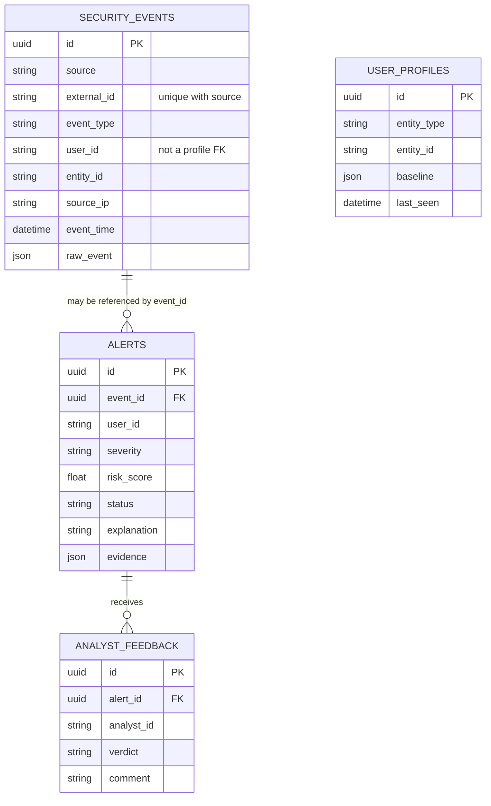

# UEBA Platform System Architecture

## Scope

This document describes the components currently present in the repository. The operational alert path is rule-based. ML Analytics is a demo-only API/UI over the bundled synthetic fixture; it does not score stored/live events, run during ingestion, or create operational alerts.

## Operational architecture

```mermaid
flowchart LR
    Analyst[Analyst in browser] --> SPA[React + TypeScript SPA]
    SPA -->|JSON over HTTP| API[FastAPI application]
    API --> DB[(PostgreSQL)]

    SPA --> Overview[Overview page]
    SPA --> AlertsUI[Security Alerts page]
    SPA --> EventsUI[Events page]
    SPA --> UsersUI[User Analytics page]
    SPA --> MLU[ML Analytics page]

    API --> Ingest[POST /events]
    Ingest -->|insert / idempotent duplicate check| EventTable[(security_events)]
    API --> EventList[GET /events]
    EventList --> EventTable

    API --> BaselineRoutes[GET /baselines/{user_id}\nPOST /baselines/{user_id}/rebuild]
    BaselineRoutes --> BaselineService[build_user_baseline]
    BaselineService --> EventTable
    BaselineService --> ProfileTable[(user_profiles)]

    API --> Analyze[POST /anomalies/analyze/{event_id}]
    Analyze --> RuleEngine[services/anomaly.py]
    RuleEngine --> EventTable
    RuleEngine --> ProfileTable
    RuleEngine -->|risk >= 30| AlertTable[(alerts)]

    API --> AlertRoutes[GET/PATCH /alerts]
    AlertRoutes --> AlertTable
    API --> FeedbackRoutes[POST/GET /alerts/{id}/feedback]
    API --> MLDemo[GET /ml-analytics/demo]
    FeedbackRoutes --> FeedbackTable[(analyst_feedback)]
    MLDemo --> DemoService[In-memory synthetic demo service]
    DemoService -. reads bundled fixture only .-> SyntheticFixture[Committed synthetic CSV]
    AlertRoutes --> FeedbackUI[Alert investigation dialog]
    FeedbackRoutes --> FeedbackTable
```

The browser uses the configured API base URL, defaulting in `frontend/src/api.ts` to `http://127.0.0.1:8001`. `backend/app/main.py` allows the local Vite origins `localhost:5173` and `127.0.0.1:5173`. App page selection is React state in `App.tsx`; it is not routed through React Router.

## Implemented component data flow

### Event ingestion and listing

`POST /events` validates a `SecurityEventCreate` request, including a timezone-aware `event_time`, then inserts a `SecurityEvent`. PostgreSQL's unique `(source, external_id)` constraint prevents duplicate event creation. A repeated pair returns the existing event with duplicate status. Ingestion alone does not execute the anomaly detector.

`GET /events` supports `user_id`, `event_type`, and `source` filters plus `limit`/`offset`. It returns newest-first event records with a total count. Event details can display the source-provided JSON `raw_event`; use sanitized synthetic values when demonstrating.

### Baselines

`POST /baselines/{user_id}/rebuild` calls `build_user_baseline`. That service reads all rows for the user ordered by `event_time` and writes counts into `user_profiles.baseline`: event count, event type counts, UTC login hour counts, source IP counts, active day count, first seen, and last seen. `GET /baselines/{user_id}` reads the stored profile. There is no baseline history/version table, time-window argument, or automatic aging policy.

### Rule analysis and alerts

An analyst selects an event for explicit analysis. `POST /anomalies/analyze/{event_id}` loads the event and its stored user baseline and calls `services/anomaly.py`. It scores unfamiliar IP (+40), unfamiliar event type (+25), and unfamiliar UTC login hour (+30 for login event types), capped at 100. Score 30 or higher is anomalous and can create/update an alert; below 30 the route returns a result without an alert. Severity is low/medium/high/critical at the implemented score bands. The saved evidence identifies `detection_method: "rule_based"` and includes reasons and the baseline event count.

`GET /alerts` supports status, severity, user ID, limit, and offset. `GET /alerts/{alert_id}` returns detail. `PATCH /alerts/{alert_id}/status` updates status. Feedback routes create/list analyst verdicts and comments attached to an alert. There is no authentication layer; the client-submitted analyst ID is not verified.

## Data model



`user_profiles` is keyed by unique `(entity_type, entity_id)` but no FK binds `security_events.user_id` to it. `alerts.event_id` points to `security_events.id` and becomes null if that event is deleted. `analyst_feedback.alert_id` points to `alerts.id` and feedback is deleted if its alert is deleted. No ML model or detection table exists.

## Frontend components

`App.tsx` owns state-driven page navigation and global refresh. The `Sidebar` entries are Overview, Security Alerts, User Analytics, Events, and ML Analytics; AI SOC Assistant remains disabled/planned. `PageHeader` describes the active page and invokes refresh. Page components use typed functions in `frontend/src/api.ts`.

- Overview calls filtered alert list requests to obtain global response totals and displays latest alerts and events.
- Alerts supports backend severity/status filtering and text search within the currently loaded page, then opens the alert investigation dialog.
- Events supports only backend-provided event filters and pagination. It can open details or navigate to User Analytics to explicitly analyze a stored event.
- User Analytics suggests identifiers found in up to 100 returned events and alerts (not a complete directory), reads/rebuilds a baseline, shows related event/alert pages, and displays rule-analysis results.
- ML Analytics calls `GET /ml-analytics/demo` only when requested and displays synthetic model/demo/evaluation values. The endpoint has no database dependency and creates no artifacts or alerts.

## Offline experimental ML workflow

This diagram is separate from the operational diagrams above.

```mermaid
flowchart LR
    MLU[ML Analytics page] -->|button requests demo| DemoAPI[GET /ml-analytics/demo]
    DemoAPI --> DemoSvc[In-memory demo service]
    FixtureCSV[(Bundled synthetic CSV)] --> DemoSvc
    DemoSvc -->|JSON: scenarios and held-out metrics| MLU

    Source[(PostgreSQL event records)] -->|read-only query, inclusive cutoff| Extract[Offline snapshot CLI]
    Extract --> Dedup[Deduplication and input checks]
    Dedup --> Pseudo[Namespace-separated HMAC pseudonyms]
    Pseudo --> Features[Shared point-in-time feature engine\nueba-seven-v2]
    Features --> Split[Chronological train / validation / test manifests]
    Split --> Snapshot[Local sanitized dataset snapshot]
    Snapshot --> Validate[Schema, provenance, split, digest validation]
    Validate --> Scale[StandardScaler fit on train only]
    Scale --> IF[Experimental Isolation Forest fit on train only]
    IF --> Eval[Held-out synthetic evaluation or unlabeled snapshot score report]
    Eval --> Artifacts[Local model and experiment metadata with hashes]
    Scenarios[Synthetic scenario labels] -. evaluation only .-> Eval

    RULE[Operational rule analysis] --> ALERT[Operational alerts]
    DemoSvc -. no live-event inference or alert connection .-> ALERT
    Artifacts -. no production serving .-> ALERT
```



The demo API reads only the fixed committed synthetic CSV and builds results in memory; it never accepts a path or command from a caller. The separate snapshot pipeline reads PostgreSQL in read-only mode. Its HMAC key stays in the local environment and is not written into snapshot reports. A key ID may be recorded for reproducibility; it is not the key. Snapshot environment provenance is a defense-in-depth declaration, not cryptographic proof of origin. Training loaders accept development/test snapshots and reject production, unclassified, or legacy v1 feature semantics. Snapshot-to-model validation uses synthetic records in a disposable PostgreSQL cluster.

### Feature vector

The fixed order defined by `ml_anomaly.FEATURE_NAMES` is:

| Index | Name | Interpretation |
| ---: | --- | --- |
| 1 | `hour_sin` | Sine of UTC event hour in a 24-hour cycle. |
| 2 | `hour_cos` | Cosine of UTC event hour. |
| 3 | `is_login` | Login substring flag based on normalized event type. |
| 4 | `is_known_ip` | Prior same-user familiarity of normalized valid source IP. |
| 5 | `is_known_event_type` | Prior same-user familiarity of event type. |
| 6 | `user_event_frequency` | Log-transformed same-user prior 24-hour event count. |
| 7 | `source_ip_frequency` | Log-transformed earlier same-user count for the IP. |

The shared feature engine uses strictly earlier events and excludes future and equal-time events. It does not read mutable all-history baseline JSON as a feature source.

## Architecture boundary and deployment status

The system is a local development/college project, not an internet-facing deployment. No user authentication/authorization, production inference endpoint, production model registry, model promotion process, ML detection persistence, or ML-driven alert policy is implemented. The rule-based alert route remains the only active alert-generation path.

